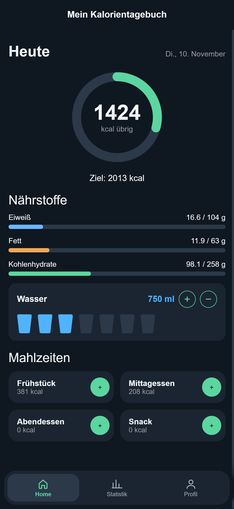
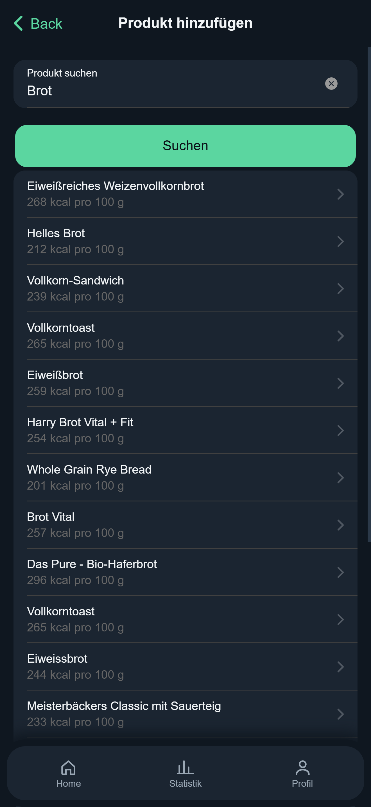
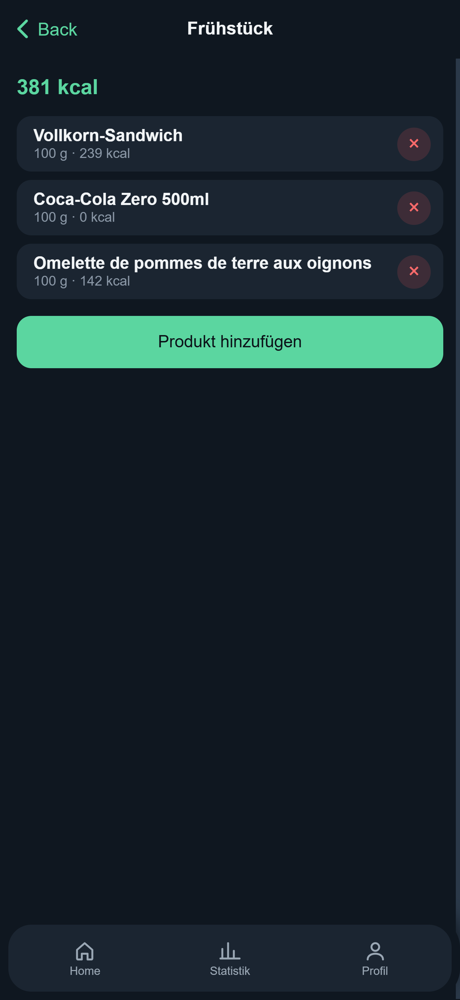
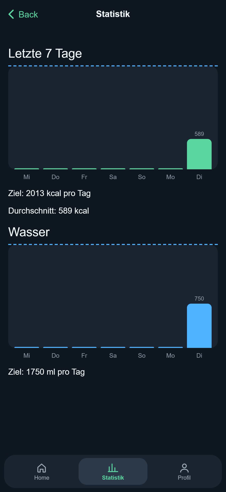
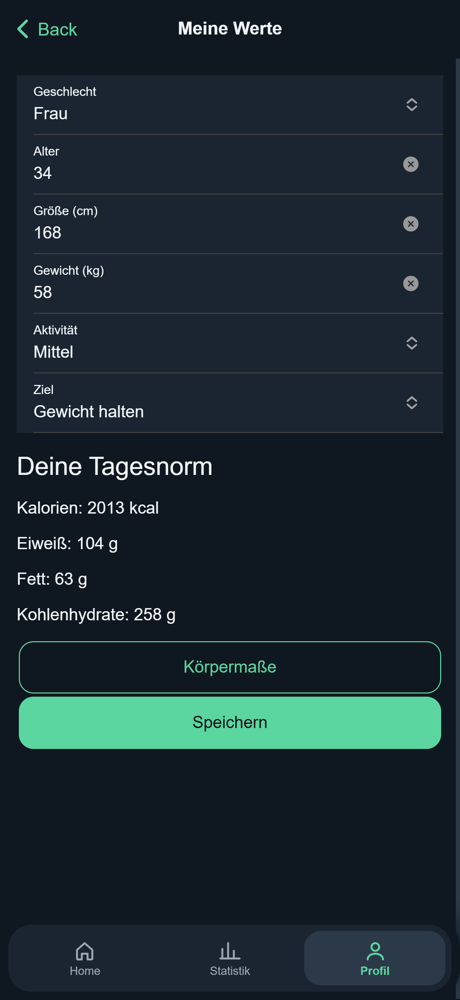

# Kalorien-App

A calorie and nutrition tracking app built as a learning project with Angular and Ionic. It calculates a personal daily calorie and macro target and lets you log meals, water and body measurements.

## Features

- **Personal targets:** daily calories and macros (protein, fat, carbs) calculated from sex, age, height, weight, activity level and goal (Mifflin-St Jeor formula)
- **Food diary:** log food by meal (breakfast, lunch, dinner, snack); data is saved per day
- **Product search:** look up products and their nutrition values via the Open Food Facts API
- **Water tracker:** daily water goal based on body weight, tracked in glasses
- **Statistics:** calories and water for the last 7 days
- **Body measurements:** weight and body circumferences with a change compared to the previous measurement, plus an estimated body fat percentage
- **Dark UI:** custom theme based on my own design concept

## Tech stack

- Angular 20 (standalone components)
- Ionic
- TypeScript, SCSS
- Open Food Facts API
- `localStorage` for data persistence

## Run locally

```bash
npm install
ionic serve
```

## Notes

- Body fat and calorie values are estimates and not medical advice.
- Data is stored only in the browser (`localStorage`).

## Screenshots

<p>
  
  
  
</p>
<p>
  
  
</p>
